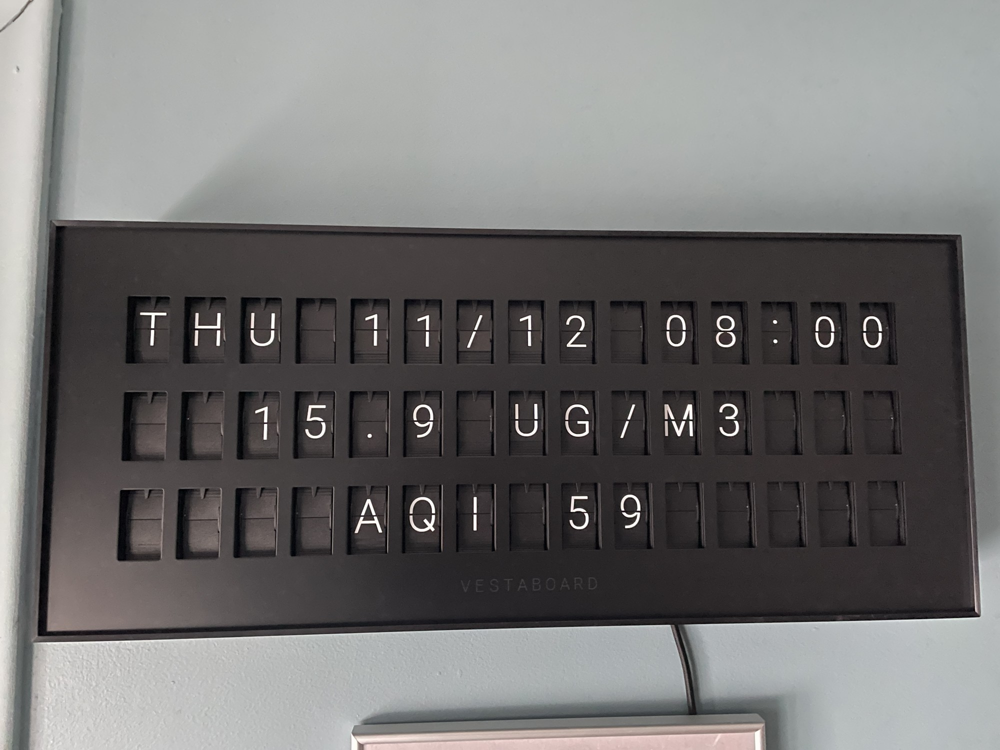
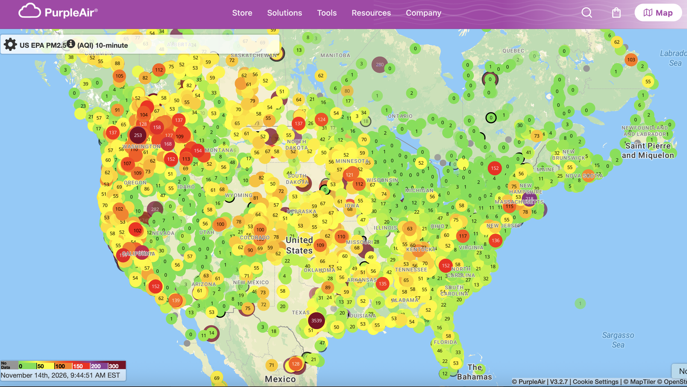
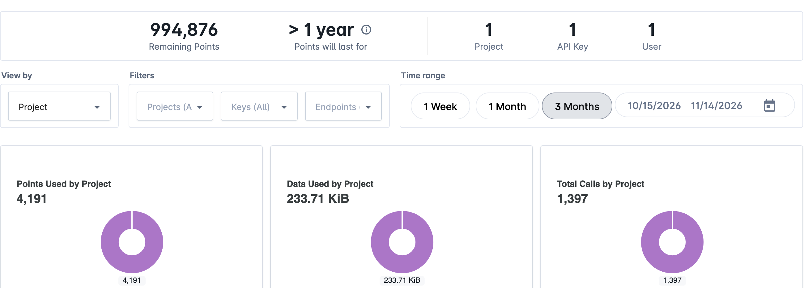

# pm25-flipboard

Show your local air quality on a [Vestaboard Note](https://www.vestaboard.com/) split-flap display, using readings from your own [PurpleAir](https://www.purpleair.com/) sensor. A small Python script, run on a schedule, fetches the latest PM2.5 reading and flips the board when the air is worse than a threshold you choose.



```
THU 11/12 08:00
15.9 UG/M3
AQI 59
```

[Video of the board updating (MP4)](video/sample-run.mp4)

> **Disclaimers, please read**
>
> - **The Python code was written by Claude**, an AI model made by Anthropic, in chat sessions. It was then tested and deployed by the repository owner on a MacBook and a Raspberry Pi. It has not had an independent code review. See [How this was made](#how-this-was-made).
> - **Not affiliated with or endorsed by PurpleAir or Vestaboard.** Both names are trademarks of their respective owners and are used here only to describe what the project works with.
> - **Not health advice.** The AQI shown on the board is a straight conversion of the *raw* sensor value, with no humidity correction, so it can read noticeably higher than the AQI on the PurpleAir map. For health decisions, use official sources such as [AirNow](https://www.airnow.gov/).
> - **PurpleAir API pricing changes.** The point costs below are a snapshot from November 2026. Check PurpleAir's current pricing before relying on them.
> - **Provided as is, with no warranty.** See [LICENSE](LICENSE).

## Contents

- [What you need](#what-you-need)
- [What's in this repo](#whats-in-this-repo)
- [The recipe](#the-recipe)
- [How the project evolved](#how-the-project-evolved)
- [API cost](#api-cost)
- [Troubleshooting](#troubleshooting)
- [Future ideas](#future-ideas)
- [How this was made](#how-this-was-made)
- [License and credits](#license-and-credits)

## What you need

- A PurpleAir sensor, plus its **sensor index** and a PurpleAir **API read key**
- A Vestaboard Note, plus a Vestaboard **Cloud API token** with the *Write* permission
- A computer that can run Python 3 and the `requests` package. A Mac or any Linux machine works, and a Raspberry Pi is a good always-on choice.

## What's in this repo

| Path | What it is |
|---|---|
| `code/purpleair_to_vestaboard_datetime.py` | The main script. Posts date/time, PM2.5 and AQI, **only when PM2.5 is at or above the threshold**. This is the one to schedule. |
| `code/purpleair_to_vestaboard_ping.py` | A "ping" test script. Same logic, but it updates the board on every run and shows a label instead of the date. Use it to check the whole chain works end to end. |
| `docs/code-walkthrough.md` | A line-by-line explanation of what the code does. |
| `examples/crontab.example` | A sample crontab entry. |
| `images/`, `video/` | Photos and a clip of the board in action. |

## The recipe

### 1. Get your credentials

1. **PurpleAir read key.** Request one through the developer process described in the [PurpleAir community API forum](https://community.purpleair.com/c/data/api/18).
2. **Sensor index.** On [map.purpleair.com](https://map.purpleair.com), click your sensor and read the number after `select=` in the URL.
3. **Vestaboard token.** In the Vestaboard web app, open the Developer/API section, choose *Create New Token*, and enable **Write**. The token is shown only once, so save it somewhere safe.

### 2. Install the dependency

```bash
pip install -r requirements.txt
```

On a recent Raspberry Pi OS you may also need `--break-system-packages`.

### 3. Add your credentials *without committing them*

The scripts read three values, either from environment variables or from the fallback strings in the `CONFIG` block near the top of each file:

```python
PURPLEAIR_API_KEY = os.environ.get("PURPLEAIR_API_KEY", "YOUR_PURPLEAIR_API_KEY")
PURPLEAIR_SENSOR_INDEX = os.environ.get("PURPLEAIR_SENSOR_INDEX", "YOUR_SENSOR_INDEX")
VESTABOARD_API_TOKEN = os.environ.get("VESTABOARD_API_TOKEN", "YOUR_VESTABOARD_TOKEN")
```

- **Safest:** export them as environment variables and leave the file untouched.
- **Simplest (what this project did on its own machines):** type the real values into those fallback strings in a local copy. Only do this if the file never leaves your machine, and **never commit or share it**. A key that has been pushed to git or pasted into a chat should be treated as burned (see [Troubleshooting](#i-accidentally-exposed-an-api-key)).

If any of the three values is empty or still a `YOUR_...` placeholder, the script refuses to run and tells you which one is missing.

### 4. Test with the ping script

```bash
python3 code/purpleair_to_vestaboard_ping.py
```

This always updates the board, so it proves that both APIs and both credentials work. The board shows:

```
SENSORNAME
46.5 UG/M3
AQI 128
```

Change `SENSOR_LABEL` in that file to whatever name you like (15 characters at most).

### 5. Run the real script

```bash
python3 code/purpleair_to_vestaboard_datetime.py
```

If PM2.5 is below `THRESHOLD_PM25` (default `12.1` µg/m³, the point where AQI leaves "Good"), nothing is sent and the script just prints the reading. Set the threshold to `0` to update on every run.

### 6. Schedule it

Cron is the scheduler built into macOS and Linux. Open your crontab with `crontab -e` and add a line like the one in [`examples/crontab.example`](examples/crontab.example):

```
*/30 7-22 * * * /usr/bin/python3 /full/path/to/code/purpleair_to_vestaboard_datetime.py >> $HOME/aq_vestaboard.log 2>&1
```

- `*/30` means every 30 minutes, at **:00 and :30 on the wall clock**. The schedule is not relative to boot time.
- `7-22` restricts runs to the hours 7:00 through 22:59, so the board stays quiet overnight. A split-flap display is audible.
- Cron on a laptop does not run while it is asleep, and missed runs are not made up later.
- Use `which python3` to get the right interpreter path, and always use full paths in a crontab.
- To pause the job, put a `#` at the start of the line. To remove it, run `crontab -r` (this deletes *all* your cron jobs).

### 7. (Optional) Move it to a Raspberry Pi

A Raspberry Pi stays on around the clock, so cron runs are never skipped. This project was moved to a Pi 3 like so:

1. Flash Raspberry Pi OS, join WiFi and enable SSH.
2. Copy the script over, for example `scp code/purpleair_to_vestaboard_datetime.py youruser@raspberrypi.local:~/`.
3. On the Pi, install `requests`, then **set the time zone** with `sudo raspi-config` (Localisation Options, then Timezone). Otherwise the date and time on the board will be wrong, because the script uses the machine's local clock.
4. Enter your credentials in the Pi's copy, run it once by hand, then add the same cron line with the Pi's paths.

No code changes are needed. The Pi has no battery-backed clock, but with network time sync it corrects itself soon after boot.

## How the project evolved

The project was built in small steps. The wrong turns are kept here because they explain why the final script looks the way it does.

1. **First version.** Fetch PM2.5 from the sensor, apply the EPA/PurpleAir humidity correction, convert to AQI and show a category such as `GOOD`. It requested four fields from the API.
2. **Raw concentration instead of AQI.** The goal turned out to be the PM2.5 value itself (µg/m³), not an index, so the AQI conversion was dropped.
3. **Surprise: the PurpleAir map showed a very different number.** The board said 46.5 while the map said 119. The map displays the **EPA AQI** (a converted 0 to 500 scale), not µg/m³.
4. **AQI added back, beside the raw value.** Both numbers now share the board so you can get a feel for how the scales differ.
5. **Cost trimming.** The humidity correction needed extra API fields (`pm2.5_cf_1`, `humidity`). Since API calls cost points, the script went back to a single field, `pm2.5_atm`. The catch is that the board's AQI is now *uncorrected* and runs higher than the map's.
6. **Threshold.** The board updates only when PM2.5 reaches `12.1` µg/m³, so a quiet, clean-air board stays quiet.
7. **Date and time.** The sensor-name line was replaced with `TUE 07/21 14:32` (exactly 15 characters, the full width of the Note), so each update is timestamped.
8. **Scheduling and the Pi.** Cron with a daytime-only window, first on a MacBook, then on a Raspberry Pi 3.

### The board layout

A Vestaboard Note is **15 characters wide by 3 rows**. Every line the script builds fits that width.

| Row | Content | Example |
|---|---|---|
| 1 | Weekday, month/day, 24-hour time | `TUE 07/21 14:32` |
| 2 | Raw PM2.5 in µg/m³ | `46.5 UG/M3` |
| 3 | AQI from the raw value (uncorrected) | `AQI 128` |

### Why the AQI differs from the PurpleAir map

The script converts the raw `pm2.5_atm` value straight to AQI with the standard EPA table. PurpleAir's map first applies a correction that adjusts for humidity and sensor bias, then converts. For a given reading the script's AQI is usually a bit higher. If you want them to match, add the correction (see [Future ideas](#future-ideas)), at the cost of two more API fields per call.



*The PurpleAir map's default layer is the US EPA PM2.5 AQI, not raw µg/m³.*

## API cost

PurpleAir bills API reads in "points": a base cost per call plus a cost per field requested, per data row. The dashboard below covers 10/15/2026 to 11/14/2026 and shows **4,191 points for 1,397 calls**, which is **3 points per call** for the single-field request this script makes.



For scale, at 3 points per call a schedule of every 30 minutes from 07:00 to 22:30 (32 calls a day) uses about 96 points a day. This is a snapshot, and PurpleAir may change the pricing and how many points new accounts receive. See their [API pricing](https://community.purpleair.com/t/api-pricing/4523) and [points for sensor owners](https://community.purpleair.com/t/api-points-for-sensor-owners/7525) pages.

## Troubleshooting

These are real problems hit while building this.

### The cron log says `can't open file ... No such file or directory`

Cron is pointing at a path that no longer exists. Here the script had been renamed with a version number and the crontab entry was never updated. Compare `crontab -l` against the actual file name and path.

### The cron log says `Operation not permitted` (macOS)

macOS privacy protections block background jobs from reading protected folders such as `~/Documents`, `~/Desktop` and `~/Downloads`. Either:

- move the script to a folder under your home directory that is not protected (for example `~/scripts/`) and update the crontab path, or
- grant Full Disk Access to the relevant binary in *System Settings, Privacy & Security*.

This project sidestepped the issue by moving to a Raspberry Pi, so the Full Disk Access route was not tested here. The Pi has no such restriction.

### The Pi is unreachable from another room (`Host is down`, `No route to host`)

Signal strength looked fine (about -55 dBm), but the log showed the Pi had associated with the access point on **5 GHz**, which carries poorly through floors. Pinning the connection to **2.4 GHz** fixed it. On a recent Raspberry Pi OS (NetworkManager, with profiles generated by netplan) there is no `wpa_supplicant.conf` to edit, so use `nmcli`:

```bash
nmcli connection show                      # find your WiFi profile name
sudo nmcli connection modify "<profile name>" 802-11-wireless.band bg
sudo nmcli connection up "<profile name>"
iwconfig wlan0                             # frequency should now read 2.4xx GHz
```

Netplan-generated profiles can be regenerated, so confirm the band is still 2.4 GHz after a reboot. If it reverts, make the change in the YAML under `/etc/netplan/` instead.

### `HTTPError: 423 Client Error: Locked` from `cloud.vestaboard.com`

The board had stopped updating after weeks of working. Sending a message from the Vestaboard phone app only worked after overriding **Quiet Hours**, and turning Quiet Hours off fixed the script. Vestaboard does not document a 423 response, so Quiet Hours is the observed cause rather than a confirmed one. Either turn Quiet Hours off, make sure it does not overlap your cron window, or see [Future ideas](#future-ideas) for the API's `forced` option.

### The script's AQI does not match the PurpleAir map

Expected. See [Why the AQI differs from the PurpleAir map](#why-the-aqi-differs-from-the-purpleair-map).

### A urllib3 `NotOpenSSLWarning` prints on macOS

macOS's system Python is built against LibreSSL, and recent `urllib3` warns about it. It is harmless here. The requests still work, and you can ignore the warning.

### I accidentally exposed an API key

Treat the key as compromised, even if you deleted it right away:

1. **PurpleAir:** request a new read key.
2. **Vestaboard:** revoke the token in the Developer section and create a new one.
3. Put the new values in your local copy only, and test it.

Anything pushed to git stays in the history even after you delete the file, which is why this repo ships only placeholders.

### Rate limits

Vestaboard drops messages sent more often than about once every 15 seconds. A 30-minute schedule is nowhere near that.

## Future ideas

Not implemented. Listed so the repo shows only the code that actually ran.

- **Error handling and logging.** The script lets any HTTP error raise an exception. A `try/except` that logs the failure would have made the 423 above much quicker to diagnose.
- **Retry with backoff** for transient network errors.
- **Optional humidity correction**, so the AQI line matches the PurpleAir map, using `pm2.5_cf_1` and `humidity` (more points per call).
- **Use the API's `forced` flag** (documented in Vestaboard's Cloud API as the way to override Quiet Hours) if you want alerts to get through during Quiet Hours.
- **Color tiles.** Vestaboard has colored character codes, so the board could show a color for each AQI category.
- **A log path that survives reboots, and log rotation.** `/tmp` is cleared at boot on many systems.
- **`.env` file support** (for example with `python-dotenv`) instead of editing the script.
- **A systemd timer** instead of cron on the Pi.
- **Remote access to the Pi** from outside the home network, for example with Raspberry Pi Connect or Tailscale, rather than opening ports on the router.
- **A stable address for the Pi**, through a DHCP reservation on the router or its `.local` hostname.
- **Multiple sensors** or a second line of data such as temperature.

## How this was made

The Python code in this repository was **written by Claude** (Anthropic's AI model), through a series of chat sessions with the repository owner. The owner set the goals and the display layout, decided what to keep or drop at each step, supplied the credentials, ran everything on real hardware (a MacBook and a Raspberry Pi 3), debugged the real-world problems above, and took the photos and video.

This README and the code walkthrough were also drafted by Claude, from the transcript of those chat sessions, and then assembled into this repo. Treat the code as you would any untested third-party script: read it, understand it, and test it before you depend on it. It is short enough to read in a few minutes.

## License and credits

Released under the [MIT license](LICENSE).

**Credits:** the Python scripts in `code/`, this README and `docs/code-walkthrough.md` were written by [Claude](https://www.anthropic.com/claude) (Anthropic), working from requirements and testing supplied by the repository owner. Each script says so in its header.
